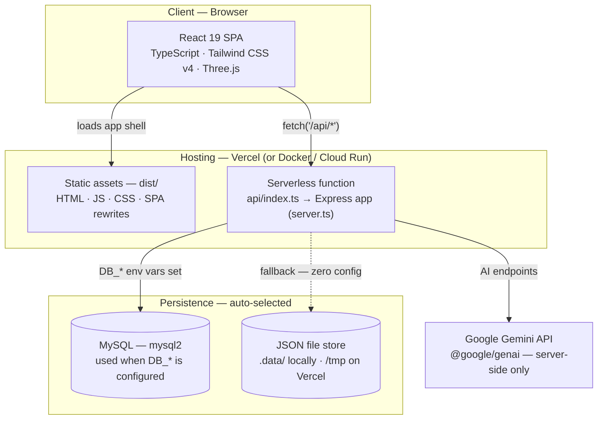

# TimeForge

**A smart timetable & progress tracker for students** — rotating class schedules, a 3D completion torus, Toggl-style time logging, daily streaks, and a Google Gemini AI assistant that turns your syllabus into an actionable plan.

**Live demo:** [time-table-app-dun.vercel.app](https://time-table-app-dun.vercel.app)


---

## ✨ Features

- **📅 Rotating timetable** — a class schedule that rotates through the week, built for day-wise rotating timetables.
- **🔮 3D completion torus** — a Three.js ring that fills up as you complete your day.
- **✅ Daily routines & streaks** — every new account gets 12 default routine tasks; track completions, progress, history, and streaks.
- **⏱️ Toggl-style time logging** — a timer bar to log focused time as you work.
- **🤖 AI study assistant (Gemini)** — chat with an agent, parse messy notes into tasks, split big tasks into steps, generate weekly summaries, and turn a syllabus into a study plan.
- **👤 Accounts & roles** — register/login with bcrypt-hashed passwords and sessions; role-gated admin panel and announcements.
- **🗄️ Adaptive storage** — zero-config JSON file store out of the box, or MySQL by setting `DB_*` variables. Tables are created automatically.
- **🚀 One codebase, deploy anywhere** — Vercel (static SPA + serverless API) or Docker (Cloud Run-ready).

## 🏗️ Architecture



The **same Express application** (`server.ts`) powers every mode — the local dev server, the Vercel serverless function, and the Docker container:

| Mode | How it runs | Entry point |
| --- | --- | --- |
| **Development** | Single Express server with Vite in middleware mode | `npm run dev` → `tsx server.ts` |
| **Vercel** | Static SPA from `dist/` + `/api/*` handled by a serverless function | `api/index.ts` |
| **Container** | One bundled Node process serving both SPA and API | `node dist/server.cjs` (port `8080`) |

**How a request flows (on Vercel):**

1. The browser loads the React SPA (static files; all non-API routes rewrite to `index.html`).
2. UI calls to `/api/*` are rewritten by `vercel.json` to the serverless function.
3. The function boots the Express app and routes the request (auth, tasks, streaks, AI…).
4. Data goes to MySQL when `DB_*` is configured — otherwise to the JSON file store (`.data/` locally, `/tmp/timeforge-data` on Vercel).
5. AI endpoints call Google Gemini **server-side only** — the API key never reaches the browser.

## 🧰 Tech Stack

| Layer | Technologies |
| --- | --- |
| **Frontend** | React 19 · TypeScript · Vite 6 · Tailwind CSS v4 · motion · Recharts · Three.js · lucide-react · react-markdown |
| **Backend** | Node.js · Express 4 · tsx (dev) · esbuild (bundle) · bcryptjs · dotenv |
| **AI** | Google Gemini via `@google/genai` (server-side) |
| **Data** | MySQL via `mysql2` *(optional)* · JSON file store *(default)* |
| **Deployment** | Vercel (serverless) · Docker (multi-stage, Cloud Run-ready) |

## 📂 Project Structure

```
TimeForge/
├── api/
│   └── index.ts            # Vercel serverless entry → the Express app
├── src/                    # React frontend
│   ├── components/         # Timetable, task board, modals, admin panel, 3D ring…
│   ├── App.tsx             # App shell & views
│   ├── index.css           # Tailwind entry
│   └── types.ts
├── server.ts               # Express app: auth, tasks, streaks, AI + storage layer
├── vercel.json             # /api/* → function · everything else → SPA
├── vite.config.ts
├── Dockerfile              # Multi-stage build for container hosting
├── .env.example            # Environment template
└── package.json
```

## 🚀 Getting Started (local)

### Prerequisites

- **Node.js 20+** (tested on 22 & 24) and npm
- *(Optional)* **MySQL 8+** — only if you want database-backed persistence
- *(Optional)* **Gemini API key** — required for the AI features → [get one in Google AI Studio](https://aistudio.google.com/apikey)

### 1 · Clone & install

```bash
git clone https://github.com/MK543-dev/TimeForge.git
cd TimeForge
npm install
```

### 2 · Configure the environment

```bash
cp .env.example .env      # Windows: copy .env.example .env
```

| Variable | Required | Description |
| --- | --- | --- |
| `GEMINI_API_KEY` | For AI features | Server-side Gemini key. Add it to your hosting platform's env vars too. |
| `APP_URL` | Optional | Public URL where the app is hosted. |
| `DB_HOST` · `DB_PORT` · `DB_USER` · `DB_PASSWORD` · `DB_NAME` | Optional | Set these to enable MySQL persistence instead of the file store. |
| `DB_SSL` | Optional | `true` to connect to MySQL over SSL. |
| `PORT` | Optional | Local server port (default `3000`). |
| `DATA_DIR` | Optional | Custom directory for the JSON file store. |

### 3 · Run the dev server

```bash
npm run dev
# → TimeForge full-stack server running on http://localhost:3000
```

In development, Express serves the API **and** the React app (via Vite middleware) from one process.

### 4 · Production build (locally)

```bash
npm run build                      # vite build + bundles the server → dist/
NODE_ENV=production npm start      # macOS / Linux
# Windows PowerShell: $env:NODE_ENV='production'; npm start
```

### 5 · Optional — enable MySQL

1. Create a database and user (or let the app attempt `CREATE DATABASE IF NOT EXISTS` with a privileged user).
2. Fill in the `DB_*` variables in `.env`.
3. Start the app — the tables (`users`, `sessions`, `daily_tasks`, `daily_completions`, `user_streaks`) are created automatically.

## 🔌 API Overview

| Area | Endpoints |
| --- | --- |
| **Health** | `GET /api` · `GET /api/health` |
| **Auth** | `POST /api/auth/register` · `POST /api/auth/login` · `GET /api/auth/me` · `POST /api/auth/logout` · `POST /api/auth/update-profile` |
| **Users** | `GET /api/users` · `POST /api/users/sync` |
| **Daily tasks** | `GET /api/daily-tasks` · `/definitions` · `/progress` · `/history` — `POST …/complete` · `…/toggle` · `…/batch-update` · `/streak/modify` |
| **AI (Gemini)** | `POST /api/ai/agent-chat` · `/parse-task` · `/split-task` · `/weekly-summary` · `/parse-syllabus` |

## ☁️ Deployment

### Vercel (recommended)

```bash
npm i -g vercel
vercel          # preview deployment
vercel --prod   # production deployment
```

- Add environment variables in **Vercel → Project → Settings → Environment Variables** (`GEMINI_API_KEY`, and `DB_*` if you use MySQL).
- `vercel.json` already wires the SPA rewrites and the `/api` serverless function.
- On Vercel the filesystem is read-only, so the file store automatically switches to `/tmp/…` — which is **ephemeral**. For durable data, configure MySQL.
- Want automatic deploys? Connect the repo under **Settings → Git** in the Vercel dashboard.
- Full walkthrough and troubleshooting: [`VERCEL_DEPLOYMENT.md`](./VERCEL_DEPLOYMENT.md).

### Docker / Google Cloud Run

```bash
docker build -t timeforge .
docker run --rm -p 8080:8080 --env-file .env timeforge
# → http://localhost:8080
```

The image listens on `$PORT` (default `8080`) and runs the bundled `dist/server.cjs` — deploy it as-is to Cloud Run or any container host.

### Before you deploy publicly

- Use **your own** Gemini API key and secrets — replace anything preset.
- Review and rotate any default credentials or seeded accounts shipped with the project.
- Prefer MySQL (or another managed database) so user data survives across instances.
